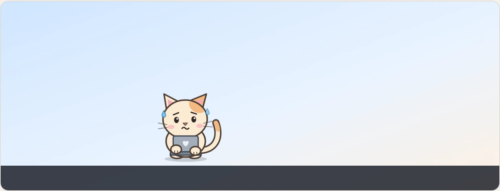
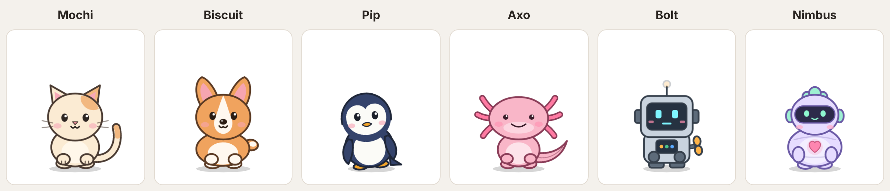
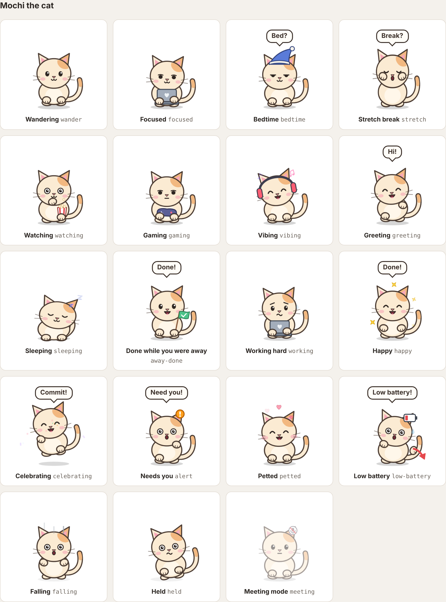

# Desktop Pet

A little animated pet that lives along the bottom of your Windows desktop and reacts to
your coding. It sweats while Claude Code works, cheers when Claude finishes, waves when
Claude needs you, and falls asleep when you step away.

**New here?** The [quick guide](GUIDE.md) covers setup and everyday use on one page.



Quick links: [Windows setup](#windows-setup) · [Connecting Claude Code](#connecting-claude-code)
· [Choosing watched folders](#choosing-watched-folders) · [Troubleshooting](#troubleshooting)
· [Browser preview](#browser-preview). How it was planned and tested: [ROADMAP.md](ROADMAP.md)
and [REVIEW.md](REVIEW.md).

---

## Features

- **A pet on your desktop.** A transparent, frameless, always-on-top strip just above the
  taskbar. The pet walks around, and clicks pass through everywhere except the pet itself.
- **Reacts to Claude Code.** It sweats while Claude works (more with several sessions),
  is happy when Claude finishes, waves when Claude is waiting for permission or an
  answer, and holds a "done" flag if Claude finished while you were away.
- **Reacts to you.** It types along when you edit files in a watched repo, throws
  confetti when you commit, sleeps when you're idle, and greets you when you're back.
- **Reacts to your apps.** Headphones for music, a controller for games, popcorn for
  videos, and it goes quiet during meetings.
- **Looks out for you.** A nightcap after bedtime, and a stretch reminder after a long
  stretch without a break.
- **Quick hide.** Press **Ctrl+Alt+P** (or use the tray) to put the pet away, and again to
  bring it back. It keeps up with what's going on while hidden.
- **Six pets to choose from**, with an optional daily shuffle.
- **A browser preview** that shows every pet in every animation, with no Windows needed.

## Pets



| Pet | Name | Looks like |
|---|---|---|
| Cat | Mochi | A cream calico with an orange patch and a curly tail |
| Corgi | Biscuit | An orange-and-white corgi with big ears and a stubby tail |
| Penguin | Pip | A round navy penguin with orange feet |
| Axolotl | Axo | A pink axolotl with frilly gills and a long tail |
| Robot | Bolt | A boxy grey robot with a screen face, an antenna and a wind-up key |
| Soft care-bot | Nimbus | A soft lavender bot with an LED visor, a cloud crest and a glowing heart |

Pick one in **Settings → Your pet** or from the tray's **Pet** menu, or turn on **A
different pet every day**. Every pet has all 18 animations.

## Animation states

| State | When | What the pet does |
|---|---|---|
| `wander` | Nothing else is going on | Walks, pauses, sits, looks around, blinks |
| `working` | A Claude Code session is working | Types frantically on a tiny laptop and sweats. More sweat with two sessions, steam with three or more |
| `happy` | Claude finished | Jumps with sparkles and a "Done!" bubble (about 8 seconds) |
| `alert` | Claude is waiting for your permission or an answer | Waves with a "Need you!" bubble until you respond |
| `away-done` | Claude finished while you were away | Waits with a little "done" flag, then cheers when you're back |
| `sleeping` | No keyboard or mouse for 5 minutes, or the screen is locked | Curls up with Zzz and slow breathing |
| `greeting` | The pet starts, you unlock, or you come back | Waves with a "Hi!" bubble (about 3 seconds) |
| `focused` | You edited files in a watched folder in the last 2 minutes, and Claude isn't working | Types calmly on its laptop |
| `celebrating` | You made a commit in a watched repo | Confetti and a "Commit!" bubble (about 4 seconds) |
| `vibing` | A music app is in front | Headphones and a head-bob |
| `gaming` | A game is in front | Mashes the buttons on a controller |
| `watching` | A video app or site is in front | Eats popcorn |
| `meeting` | A meeting app is in front | Holds still at half opacity with no bubbles |
| `bedtime` | You're still at it after 00:30 | A nightcap, yawns and the odd "Bed?" bubble |
| `stretch` | 90 minutes busy without a 5-minute break | Stretches with a "Break?" bubble |
| `petted` | You click the pet | Hearts (about 2 seconds) |
| `held` | You drag the pet | Dangles with its legs kicking |
| `falling` | You let go of it | Falls to the taskbar and squashes as it lands |

When several apply, the first of these wins: being held, dropped or petted; Claude
needing you; a celebration or Claude finishing; Claude working; Claude finished while you
were away; sleeping; greeting; an app mood; a stretch or bedtime nudge; focused;
wandering. `meeting` (and hiding while something is fullscreen) apply on top of whatever
wins. The times above are the defaults, and all of them can be changed in Settings.

<details>
<summary>All 18 states for Mochi</summary>



</details>

The [browser preview](#browser-preview) shows every pet in every state, animated.

---

## Requirements

- **Windows 10 (version 1803 or later) or Windows 11**, 64-bit. The hooks use the
  `curl.exe` that comes with Windows.
- **Claude Code**, running natively on Windows or inside WSL, for the Claude reactions.
  Everything else works without it.
- **To run from source or build the installer:** [Node.js](https://nodejs.org) 22.13 or
  later, and [Git](https://git-scm.com).
- **For Claude Code in WSL:** Windows 11 22H2 or later (see
  [Using Claude Code in WSL](#using-claude-code-in-wsl)).

## Windows setup

### 1. Get the app

**Option A: the installer.** Each CI run on GitHub builds it: open the repository's
**Actions** tab, pick the latest green **CI** run, and download the
**desktop-pet-windows** artifact. It holds two files:

- `DesktopPet-Setup-<version>.exe` installs the app for your user (no admin rights
  needed), with Start menu and desktop shortcuts and an entry in **Apps**.
- `DesktopPet-<version>-portable.exe` runs without installing. Keep it somewhere
  permanent, such as `Documents`, if you want it to start when you sign in.

You can also [build them yourself](#building-an-installer). The app isn't code-signed,
so Windows SmartScreen will warn you the first time: choose **More info → Run anyway**.

**Option B: run from source.** In PowerShell or Command Prompt:

```sh
git clone https://github.com/Parthmehta005/desktop-pet.git
cd desktop-pet
npm install
npm start
```

### 2. Say hello

The pet appears just above the taskbar and waves. Its tray icon sits by the clock
(look under the **^** arrow if it's hidden; you can drag it out to keep it visible).
Click it for the menu: hide the pet, pick a pet, pause reactions, try **Test
reactions**, or open **Settings...**. Starting Desktop Pet again while it's running
brings the pet back if it's hidden and opens its settings.

**Ctrl+Alt+P** hides the pet and shows it again, from any app. Change the shortcut, or
turn it off, in **Settings → System → Hide or show the pet**: click the box and press
the keys you want. It must use Ctrl, Alt or the Windows key, so it never gets in the
way of typing. After a restart the pet is always shown.

### 3. Connect Claude Code

In the tray menu choose **Install Claude Code hooks**, then start a new Claude Code
session. Details are in [Connecting Claude Code](#connecting-claude-code); for Claude
Code in WSL, follow [Using Claude Code in WSL](#using-claude-code-in-wsl) instead.

### 4. Pick your folders

In **Settings → Claude Code → Watched folders**, add the folders you code in. See
[Choosing watched folders](#choosing-watched-folders).

### 5. Start it when you sign in

In **Settings → System**, turn on **Start when I sign in**.

## Connecting Claude Code

The pet learns what Claude Code is doing through Claude Code **hooks**: small commands
that Claude Code runs at moments like "a prompt was sent" or "Claude finished". Each hook
is one line of `curl` that passes Claude's event on to the pet. The pet listens on
`127.0.0.1`, so nothing leaves your computer.

### Install the hooks

From the tray icon (or **Settings → Claude Code**) choose **Install Claude Code hooks**.
From a copy of this repository you can also run:

```sh
npm run hooks:install
```

This adds the pet's hooks to Claude Code's user settings,
`%USERPROFILE%\.claude\settings.json` (or `$CLAUDE_CONFIG_DIR\settings.json` if you set
that). Before changing the file, it:

- saves a backup next to it (`settings.json.desktop-pet-backup-<date>`)
- keeps all your other settings and hooks exactly as they were
- leaves the file alone if it isn't valid JSON, and tells you why

Running it again changes nothing. Afterwards, **start a new Claude Code session** (or
restart the open ones) so it picks up the hooks.

### Check they work

The tray menu should say **Claude Code: connected**, or run:

```sh
npm run hooks:status
```

Then ask Claude to do something in a watched folder. The pet starts typing and sweating,
waves when Claude needs your permission, and celebrates when Claude finishes.

| Claude Code hook | The pet |
|---|---|
| `UserPromptSubmit`, `PreToolUse`, `PostToolUse` | Works on its laptop and sweats. More sweat with more sessions at once |
| `Notification` (a permission prompt or a question) | Waves with a "Need you!" bubble |
| `Stop` | Hops with joy, "Done!". If you're away, it waits with a little flag |
| `SessionStart`, `SessionEnd` | Starts or forgets tracking that session |

A session that goes quiet for 10 minutes (for example, interrupted with Esc) stops
counting as busy. An unanswered "Need you!" gives up after 30 minutes.

### Which sessions count

- **No watched folders set:** every Claude Code session.
- **Watched folders set:** only sessions working inside them, unless you turn on
  "react to all Claude sessions".

### Privacy

Each hook hands the pet the JSON that Claude Code gives it. That can include your
prompt or a tool's input. The pet reads only:

- the event name
- the session ID
- the folder
- the notification type and text

It discards the rest and stores nothing. The hook posts only to `127.0.0.1`, uses a
private token, and is set to bypass any proxy.

### If something's off

- **The tray says the pet can't listen:** another program is using port 47321. Change
  `hookPort` in the pet's settings, then install the hooks again so they use the new
  port.
- **Status says "out of date":** the port or token changed since you installed. Install
  the hooks again.
- **The pet isn't running:** the hooks give up in under two seconds, print nothing, and
  never get in Claude's way.

### Remove the hooks

From the tray (or Settings) choose **Remove Claude Code hooks**, or run
`npm run hooks:uninstall`. Only the pet's own entries are removed, and a backup is saved
first.

## Choosing watched folders

Open **Settings** from the tray icon. Under **Claude Code → Watched folders**, choose
**Add folder…** to pick a folder, or **Remove** to stop watching one. Changes take
effect immediately.

A watched folder does three things:

- **Edits** inside it make the pet focused: it types away calmly on its laptop.
- **Commits** in its git repo make the pet throw confetti. Only real commits count
  (amends and merge commits included). Checkouts, resets, rebases and pulls don't.
- **Claude Code sessions** working inside it are the ones that count, unless you turn on
  **React to all Claude sessions**. With no watched folders at all, every session counts.

A watched folder can be:

- **a single repo**, such as `C:\Users\you\code\my-app`
- **a folder of repos**, such as `C:\Users\you\code`. Edits anywhere inside count, and
  commits are spotted in every repo directly inside it.
- **a git worktree**
- **a WSL folder**, added as `\\wsl.localhost\Ubuntu\home\you\code\app`

Tool output is ignored, so a build or `npm install` doesn't count as you coding. That
covers `node_modules`, `dist`, `build`, `out`, `target`, `bin`, `obj`, `.git`,
`coverage`, `.next`, `__pycache__`, `.venv`, `.idea` and similar folders.

## Configuration reference

Settings are saved in `%APPDATA%\desktop-pet\config.json`. The settings window is the
easiest way to change them, and every change applies straight away.

If you edit the file by hand:

- restart the pet afterwards
- a value that isn't valid falls back to its default, and the rest still apply
- a file that isn't valid JSON is renamed to `config.corrupt-<time>.json` and replaced
  with the defaults

| Setting (in the window) | `config.json` key | Default | Allowed |
|---|---|---|---|
| Pet | `pet` | `"cat"` | `cat`, `corgi`, `penguin`, `axolotl`, `robot`, `softbot` |
| A different pet every day | `shuffleDaily` | `false` | |
| Size | `petSize` | `1` | 0.5 to 2 |
| Walking speed | `walkSpeed` | `1` | 0.25 to 3 |
| Watched folders | `watchedFolders` | `[]` | Up to 50 absolute folder paths |
| React to all Claude sessions | `reactToAllSessions` | `false` | |
| Stop sweating after a quiet spell of | `workingStaleMinutes` | `10` | 1 to 240 minutes |
| Give up waving after | `alertTimeoutMinutes` | `30` | 1 to 1440 minutes |
| Hook port | `hookPort` | `47321` | 1024 to 65535. Reinstall the hooks after changing it |
| Fall asleep after | `idleMinutes` | `5` | 1 to 240 minutes |
| Stretch reminder every | `breakReminderMinutes` | `90` | 0 to 480 minutes (0 turns it off) |
| A break is at least | `breakMinutes` | `5` | 1 to 120 minutes |
| Bedtime | `bedtime` | `"00:30"` | `"HH:MM"`, or `null` to turn it off |
| Morning | `wakeTime` | `"06:00"` | `"HH:MM"` |
| Quiet during meetings | `quietDuringMeetings` | `true` | |
| Hide when something is fullscreen | `hideWhenFullscreen` | `true` | |
| App rules | `appRules` | See [App rules](#app-rules) | Up to 100 rules |
| Hide or show the pet | `toggleShortcut` | `"Ctrl+Alt+P"` | A shortcut with Ctrl, Alt or the Windows key (Super) plus one key, or `null` to turn it off |
| Start when I sign in | `launchAtLogin` | `false` | |
| Turn off hardware acceleration | `disableHardwareAcceleration` | `false` | Takes effect after restarting the pet |
| (not shown) | `hookToken` | Made on first run | The hooks' private token. Don't share it |
| (not shown) | `version` | `1` | Settings file format |

## App rules

On Windows the pet notices which app is in front and can change its mood to match. App
rules decide which app means what. Edit them under **Settings → Apps → App rules**.

How a rule matches:

- A rule matches on any of three fields, all **regular expressions, case-insensitive**:
  - **Process:** the program's name without `.exe`, such as `Spotify` or `ms-teams`.
  - **Window title:** for example `Lo-fi beats - YouTube - Google Chrome`.
  - **Install path:** for example `D:\SteamLibrary\steamapps\common\…\game.exe`.
- Every field a rule fills in must match. Leave a field empty to ignore it.
- Rules are checked **from the top**, and the first match wins. Use the arrows to
  reorder them.

The **Mood** a rule sets can be:

- **vibing:** headphones and a head-bob
- **gaming:** a controller
- **watching:** popcorn
- **meeting:** still, faded and silent, with its "Quiet during meetings" setting

The default rules cover:

| Rule | Matches | Mood |
|---|---|---|
| Music apps | Spotify, Tidal, Deezer, MusicBee, AIMP, foobar2000, iTunes, Apple Music, Amazon Music | vibing |
| Music in the browser | Titles containing YouTube Music, Spotify or SoundCloud | vibing |
| Zoom meetings | Zoom, only in a meeting or webinar window | meeting |
| Teams calls | Teams, only in a meeting or call window | meeting |
| Webex | Webex | meeting |
| Google Meet | Titles starting `Meet -` or containing Google Meet | meeting |
| Steam, Epic and other store games | Anything installed under `steamapps\common`, `Epic Games`, `Riot Games` or `XboxGames` | gaming |
| Minecraft | Titles starting with Minecraft | gaming |
| Video players | VLC, MPC-HC, MPC-BE, PotPlayer, the Netflix app | watching |
| Video sites | Titles containing YouTube, Netflix, Prime Video, Disney+, Twitch, Crunchyroll or Hulu | watching |

Examples of your own rules:

| You want | Process | Window title | Install path | Mood |
|---|---|---|---|---|
| Figma counts as vibing | `^figma$` | | | vibing |
| A game installed somewhere else | | | `^D:\\Games\\` | gaming |
| One YouTube channel is music | | `lofi girl` | | vibing (put it above "Video sites") |
| Slack huddles are meetings | `^slack$` | `huddle` | | meeting |

A pattern that isn't a valid regular expression is flagged in the window and not saved.
**Restore default rules** brings back the list above.

## Using Claude Code in WSL

If you run Claude Code inside WSL, its hooks need to reach the pet running on Windows.

1. **Turn on mirrored networking** so `127.0.0.1` inside WSL means your Windows machine.
   This needs Windows 11 22H2 or later. The pet only listens on `127.0.0.1`, so WSL's
   default NAT networking can't reach it. Add this to `%USERPROFILE%\.wslconfig`:

   ```ini
   [wsl2]
   networkingMode=mirrored
   ```

   Then run `wsl --shutdown` and open WSL again.
2. **Make sure curl is installed inside WSL:** `sudo apt install curl`.
3. **Install the hooks into WSL's Claude Code settings.** This uses the command-line tool
   from a copy of this repository on Windows (the installed app's menu only covers
   Windows' own Claude Code). It needs Node.js but no `npm install`. With the pet running
   at least once first (it makes the hook token), run this in the repository's folder,
   with your distro and user name:

   ```sh
   npm run hooks:install -- --wsl --settings "\\wsl.localhost\Ubuntu\home\<you>\.claude\settings.json"
   ```

   `--wsl` writes hooks that use Linux's `curl`.

Watched folders work across the boundary: a WSL session in `/mnt/c/Users/you/code/app`
counts as `C:\Users\you\code\app`. A folder inside the WSL filesystem can be added as
`\\wsl.localhost\Ubuntu\home\you\code\app`. To check or remove the WSL hooks, use
`hooks:status` or `hooks:uninstall` with the same `--settings` (and `--wsl` for status).

## Building an installer

On Windows, from a copy of this repository:

```sh
npm install
npm run dist:win
```

This writes to `dist\`:

| File | What it is |
|---|---|
| `DesktopPet-Setup-<version>.exe` | The installer. Installs for the current user, lets you choose the folder, and adds Start menu and desktop shortcuts and an uninstaller |
| `DesktopPet-<version>-portable.exe` | The whole app in one file, no installing |
| `win-unpacked\` | The app unpacked, as the installer would install it |

Both keep their settings in `%APPDATA%\desktop-pet`, so switching between them keeps your
settings. Neither is code-signed.

`npm run dist:dir` builds just the unpacked app, on any OS (on Linux it goes to
`dist/linux-unpacked/`), and `npm run test:packaged` then tests that build: it starts
from its archive, shows the pet, opens the settings window, finds its icons and answers
Claude Code hooks, and on Windows the foreground-app monitor reports within 10 seconds.
Building the Windows installer on Linux needs Wine; CI builds it on Windows instead and
uploads it as the **desktop-pet-windows** artifact.

## Browser preview

You can see and play with every pet without Windows or Electron. The preview runs the
same renderer code and mood engine as the desktop app.

```sh
npm install
npm run preview
```

Then open <http://127.0.0.1:4173/preview/>. The preview server only serves the
`preview/` and `src/` folders, and only to your own machine.

There are two pages:

- **Gallery** (`/preview/`): every pet in all 18 animation states, each labelled with
  what triggers it.
  - Use the **Pet** menu to pick one pet. A single pet also shows its three sweat levels
    (one, two, or three or more busy Claude sessions).
  - **Dark background** checks how the pets look on a dark desktop.
- **Stage** (`/preview/stage.html`): the real pet walking along a pretend desktop. It has:
  - **Event buttons** for everything the app reacts to: Claude Code sessions (start
    working, a second session, permission prompts, tool finished, finished), you (go idle,
    come back, lock, unlock), coding (file edits, commits), and apps (Spotify, a Zoom
    meeting, a Steam game, YouTube, a fullscreen game).
  - **Click, drag and drop:** click the pet to pet it. Drag it to carry it around, and let
    go to drop it.
  - **Time speed:** up to an hour per second, so you can see it fall asleep, nudge you to
    stretch, or (with the **Night** clock) put on its nightcap.
  - **A status panel** showing the current mood, animation, modifiers, Claude sessions and
    the clock.

The stage also accepts URL options, for example
`stage.html?pet=softbot&speed=60&wallpaper=dark&time=00:45`.

## Development and tests

### Project layout

```
src/core/       Pure logic shared by everything (no Node, Electron or DOM imports):
                the mood engine, moods, walker, path matching, app rules, config schema
src/renderer/   What you see: the pet rig, the six pets, props, animations, the
                controller that walks the pet, and the desktop window's page
src/main/       Electron main process: lifecycle, the pet window, the app:// protocol
                and security, config storage, the tray, and the event bus
preview/        Browser preview pages (gallery and stage)
assets/         Icons (SVG sources and rendered PNGs)
docs/images/    The pictures in this README
scripts/        Preview server, icon builder, Electron test runner, hooks command line
test/unit/      node:test unit tests
test/browser/   Playwright tests against the preview pages
test/electron/  Playwright tests that launch the real app
test/packaged/  Playwright tests that launch the built app
```

### Commands

| Command | What it does |
|---|---|
| `npm start` | Runs the desktop app |
| `npm run preview` | Serves the browser preview at http://127.0.0.1:4173/preview/ |
| `npm run lint` | ESLint |
| `npm test` | Unit tests |
| `npm run test:browser` | Browser tests (starts the preview server itself) |
| `npm run test:electron` | Electron tests. On Linux without a display they run inside `xvfb-run` |
| `npm run test:all` | All of the above |
| `npm run build:icons` | Re-renders the PNG icons from `assets/*.svg` |
| `npm run hooks:install` / `hooks:uninstall` / `hooks:status` | Manage the Claude Code hooks (options: `--settings <file> --user-data <dir> --wsl --host <h>`) |
| `npm run dist:win` | Builds the Windows installer and portable app (on Windows) |
| `npm run dist:dir` | Builds the unpacked app for the current OS |
| `npm run test:packaged` | Tests the built app (after `dist:dir` or `dist:win`) |

The tests never touch your real settings. Each Electron test launches the app with its
own temporary settings folder, through the `DESKTOP_PET_USER_DATA` environment variable.

On Linux, the browser tests need Playwright's Chromium (`npx playwright install
chromium`), and the Electron tests need `xvfb` (`apt-get install xvfb`).

### CI

GitHub Actions runs on every push:

- lint and unit tests on Ubuntu and Windows
- browser tests on Ubuntu
- Electron tests on Ubuntu (under xvfb) and on Windows
- on Ubuntu, the unpacked app is built and tested
- on Windows, the installer and portable app are built, the built app is tested
  (including the foreground-app monitor), and both files are uploaded as the
  **desktop-pet-windows** artifact

## Troubleshooting

**A black or white box around the pet.** Some graphics drivers can't draw transparent
windows. Turn on **Settings → System → Turn off hardware acceleration** and restart the
pet.

**"Windows protected your PC".** The app isn't code-signed. Choose **More info → Run
anyway**.

**The pet doesn't react to Claude Code.**

1. Look at the tray menu. **Claude Code: connected** means the hooks are installed. If it
   says the pet can't listen, another program has its port: change **Hook port** in
   Settings and install the hooks again.
2. Start a *new* Claude Code session after installing the hooks.
3. With watched folders set, only sessions inside them count. Add the folder, or turn
   on **React to all Claude sessions**.
4. **Test reactions** in the tray menu should make the pet move. If it doesn't, check
   that **Pause reactions** is off.
5. For Claude Code in WSL, check that WSL can reach the pet. Inside WSL,
   `curl -s -o /dev/null -w '%{http_code}\n' http://127.0.0.1:47321/` prints `404` when
   it can (that's the pet answering) and `000` when it can't: turn on mirrored
   networking.

**The pet doesn't notice my edits or commits.** Edits and commits count only in
watched folders, and not in ignored folders such as `node_modules` or `dist`.

**The pet is in the wrong place.** It lives on the primary display, just above the
taskbar, and moves when the display or taskbar changes. With an auto-hiding taskbar it
sits at the very bottom of the screen.

**The pet disappeared.** You may have hidden it: press **Ctrl+Alt+P**, or choose **Show
pet** in the tray. Otherwise something is fullscreen (a game, a video, a presentation,
or a borderless window covering the screen) and **Hide when something is fullscreen**
is on; it comes back when that window isn't in front.

**Ctrl+Alt+P does nothing.** Another app may already use it: **Settings → System** says
so under the shortcut. Click the box and press a different one.

**App moods don't change.** They only work on Windows. The pet asks a hidden
`powershell.exe` which window is in front once a second; if PowerShell is blocked on
your computer, app moods are off but everything else works. Check the rule under
**Settings → Apps → App rules**: the first matching rule wins.

**Start over.** Quit the pet and delete `%APPDATA%\desktop-pet\config.json`. The next start
writes fresh defaults (and a new hook token, so install the hooks again).

**See what it's saying.** Warnings go to the console. Run the pet from source with
`npm start` to see them in the terminal.

## Uninstalling

1. **Remove the hooks** while the pet is still installed: tray → **Remove Claude Code
   hooks**. For WSL, run `npm run hooks:uninstall -- --settings <the same file>` from the
   repository. Claude Code's settings are then as they were, apart from your own changes.
2. **Turn off Start when I sign in** in Settings, so Windows doesn't keep a sign-in
   entry for an app that's gone.
3. **Quit** the pet: tray → **Quit Desktop Pet**.
4. **Remove the app:** **Settings → Apps → Installed apps → Desktop Pet → Uninstall**.
   For the portable app, delete the `.exe`. From source, delete the folder.
5. **Delete its settings**, if you don't plan to come back: the
   `%APPDATA%\desktop-pet` folder. The uninstaller leaves it so a reinstall remembers
   your pet and folders.
6. Optionally delete the backups the hooks installer made:
   `%USERPROFILE%\.claude\settings.json.desktop-pet-backup-*`.
